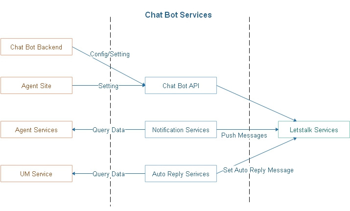

**************************
Introduction
**************************

Chat Bot API is the heart of this architecture, every request interacts with letstalk app, chat bot database ..., must go though this service.

.. image:: assets/bot-services-intro.png

Chat Bot API includes two main parts:

- Bot Client: an dll, every consumer site uses this client to access provided APIs
- Bot Services: 

    - receives requests related to bot, such as setting bot, send message to bot ...
    - run scheduled jobs to collect data and send to letstalk service
    - set auto reply messages in some cases like UM time

In this implementation, we use *Message Pack* https://msgpack.org/index.html to serialize message content