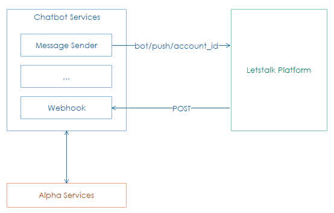

**************************
Introduction
**************************

**Chatbot services** work like `message-oriented middleware <https://en.wikipedia.org/wiki/Message-oriented_middleware>`_, play a role as a business service tier (fully asynchronous and non-blocking service tier) which abstracts away all backend services and dependencies behind facades.

The services also addresses things like security, logging, audit trail, and cross-platform communications, etc.

The following diagram and subsequent annotations display a simple layout of the architecture:

There are seven main components of chatbot:
    - `Webhook receives incoming requests from Letstalk Platform. <../webhook/introduction.html>`_ 
    - *Command* process requests regarding user Letstalk message so-called command. 
    - *Schedule* query data of SMA from **Alpha services** on schedule.
    - *Message*
        - Sender sends message to Letstalk Platform.
        - Builder receives data from *Command* or *Schedule* then produce a plain-text message.
        - Logger saves all incoming and outgoing messages across the chatbot boundary to persistent storage.
    - *Setting* API supports SMA to setup chatbot on Alpha site. 
         