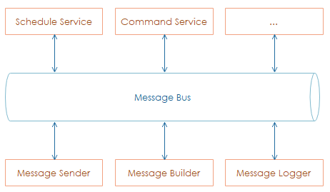

**************************
Introduction
**************************

**Chatbot services** work like `message-oriented middleware <https://en.wikipedia.org/wiki/Message-oriented_middleware>`_, play a role as a business service tier which abstracts away all backend services and dependencies behind facades.

The following diagram and subsequent annotations display a simple layout of the architecture:

.. image:: assets/chatbot-service-simpleview.png

There is no p2p connection between two services, communications inside the chatbot services boundary are all based on a **message bus**.

Technically, each service takes only one responsibility:

* `Webhook <../webhook/webhook_intro.html>`_ receives incoming requests from Letstalk Platform.
* `Command <command-service.html>`_ process requests regarding user Letstalk message so-called command.
* `Schedule <schedule-service.html>`_ query data of SMA from **Alpha services** on schedule.
* *Message*
    - Sender sends message to Letstalk Platform.
    - Builder receives data from *Command* or *Schedule* then produce a plain-text message.
    - Logger saves all incoming and outgoing messages across the chatbot boundary to persistent storage.
* `Setting <_chatbot-setting.html>`_ API supports SMA to setup chatbot on Alpha site. 
         