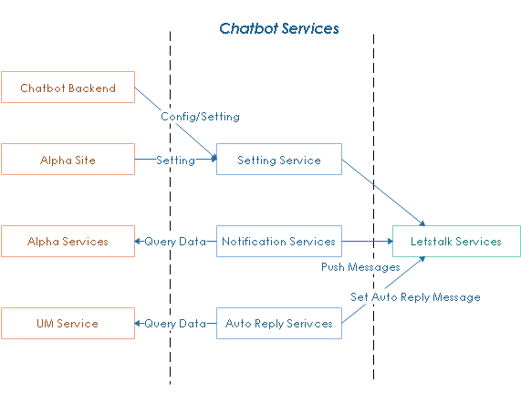

**************************
Introduction
**************************

**Chatbot services** work like `message-oriented middleware <https://en.wikipedia.org/wiki/Message-oriented_middleware>`_, play a role as a business service layer (fully asynchronous service layer) which abstracts away all backend services and dependencies behind facades.

The middleware also addresses things like security, logging, audit trail, and cross-platform communications, etc.

The following diagram and subsequent annotations explain the architecture:

.. image:: assets/bot-services-intro.png

Chatbot API includes two main parts:

- Bot Client: a dll, every consumer site uses this client to access provided APIs
- Bot Services: 

    - receives requests related to bot, such as setting bot, send message to bot ...
    - run scheduled jobs to collect data and send to letstalk service
    - set auto reply messages in some cases like UM time

In this implementation, we use *Message Pack* https://msgpack.org/index.html to serialize message content 