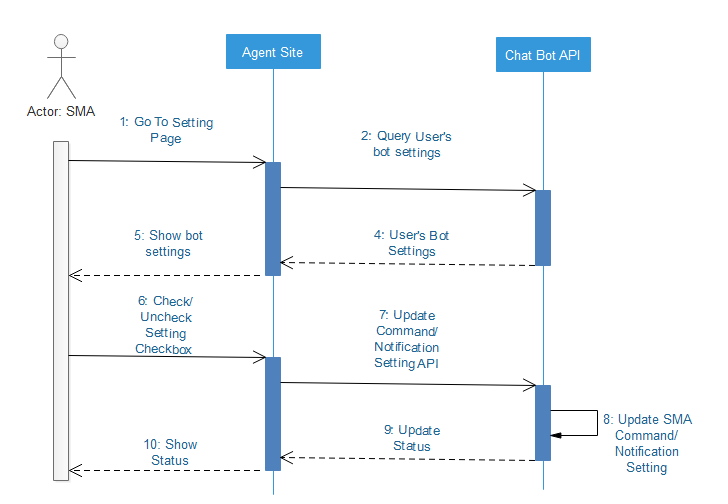
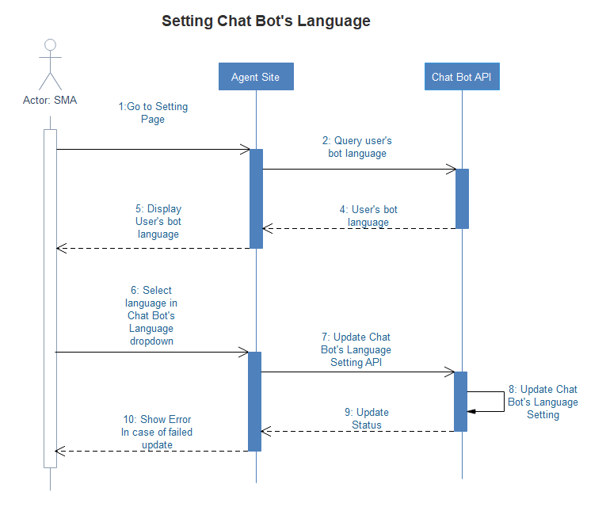
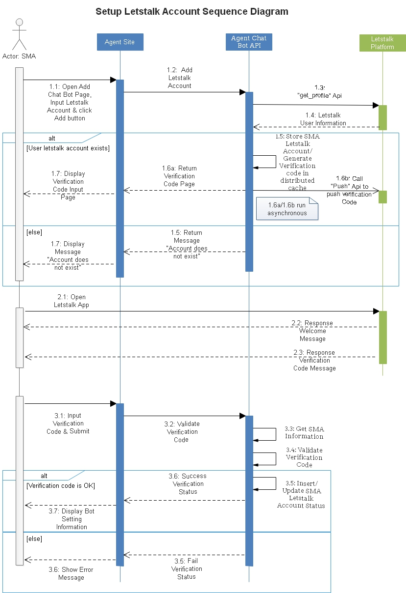

**************************
Chatbot Setting
**************************

.. contents:: Table of Contents
   :local:
   :backlinks: top

Chatbot Report & Notification Setting
=============================================

This setting allow user to set what they want to receive from letstalk bot account. This sequence diagram below describes how request is processed 

Query Bot Setting
------------------------
This API allow consumer site to query bot setting

  **Http Request:**

  ``GET: /api/bot/{cid}/setting``

  **Request Headers:**
 
  ===============  ============================
  Request Header   Description
  ===============  ============================
   Authorization    Bearer ``<token>``             
  ===============  ============================
  

  **Query Paramaters:**

  ============  =====  ===========================================================================
  Paramater     Type   Description
  ============  =====  ===========================================================================
  cid           int    customer id
  ============  =====  ===========================================================================

  **Response:**

  Returns the status code ``200`` and a JSON object.

  .. code-block:: json

    {
        "enabledOutstanding": true,
        "enabledTodayWinLoss": true,
        "enabledBalanceInfo": true,
        "enabledYesterdayWinLoss": true,
        "enabledPersonalMessage": true,
        "enabledSpecialAnnouncement": true,
        "enabledNormalAnnouncement": true
    }

----------------------

Update Bot Setting
------------------------
This API allow consumer site to update bot setting in order to receive reports/notifications from bot account

  **Http Request:**

  ``POST: /api/bot/{cid}/setting``

  **Request Headers:**

  ===============  ============================
  Request Header   Description
  ===============  ============================
   Authorization    Bearer ``<token>``             
  ===============  ============================

  **Query Paramaters:**

  ============  =====  ================
  Paramater     Type   Description
  ============  =====  ================
  cid           int    customer id
  ============  =====  ================

  **Request Body:**

  .. code-block:: json

    {
        "enabledOutstanding": true,
        "enabledTodayWinLoss": true,
        "enabledBalanceInfo": true,
        "enabledYesterdayWinLoss": true,
        "enabledPersonalMessage": true,
        "enabledSpecialAnnouncement": true,
        "enabledNormalAnnouncement": true
    }

  **Response:**

  Returns the status code ``200`` and a JSON object.

  .. code-block:: json

    {
        "code": 0,
        "message": "Updated successfully!"
    }

  **Return Code Information:**

  ============  =================================
  Code          Description
  ============  =================================
  0             Updated successfully!
  ------------  ---------------------------------
  x             Other code will be defined later
  ============  =================================

----------------------

Chatbot Language Setting
==================================

In setting page, we allow user to set what language they want receive from bot

Query Bot Language
------------------------
This API allow consumer site to query user's bot language

  **Http Request:**

  ``GET: /api/{cid}/language``

  **Request Headers:**

  ===============  ============================
  Request Header   Description
  ===============  ============================
   Authorization    Bearer ``<token>``             
  ===============  ============================

  **Query Paramaters:** 

  ============  =====  ===========================================================================
  Paramater     Type   Description
  ============  =====  ===========================================================================
  cid           int    customer id
  ============  =====  ===========================================================================

  **Response:**

  Returns the status code ``200`` and a JSON object.

  .. code-block:: json

    {
        "language": "en-US"
    }

----------------------

Update Bot Language
------------------------
This API allow consumer site to update bot language

  **Http Request:**

  ``POST: /api/bot/{cid}/language``

  **Request Headers:**

  ===============  ============================
  Request Header   Description
  ===============  ============================
   Authorization    Bearer ``<token>``             
  ===============  ============================

  **Query Paramaters:**

  ============  =====  ===========================================================================
  Paramater     Type   Description
  ============  =====  ===========================================================================
  cid           int    customer id
  ============  =====  ===========================================================================

  **Request Body:**

  .. code-block:: json

    {
         "language": "en-US"
    }

  ============  =======  ===================================================================================
  Paramater     Type     Description
  ============  =======  ===================================================================================
  language      string   language key, allowed languages: en-US, vi-VN, zh-CN, zh-TW, th-TH, ja-JP, ko-KR
  ============  =======  ===================================================================================

  **Response:**

  Returns the status code ``200`` and a JSON object.

  .. code-block:: json

    {
        "code": 0,
        "message": "Updated successfully!"
    }

  **Return Code Information:**

  ============  ===========================================================================
  Code          Description
  ============  ===========================================================================
  0             Updated successfully!
  ------------  ---------------------------------------------------------------------------
  x             Other code will be defined later
  ============  ===========================================================================

----------------------

Manage Letstalk Account
==================================

Setup Letstalk Account
------------------------
This is initial step for SMA can use chat bot funtion. After SMA set up, bot account is ready to send message to SMA's letstalk account

The sequence diagram below describes how set up account work

 

Add Letstalk Account
------------------------
This API allow consumer site to add user letstalk account

  **Http Request:**

  ``POST: /api/bot/{cid}/add``

  **Request Headers:**

  ===============  ============================
  Request Header   Description
  ===============  ============================
   Authorization    Bearer ``<token>``             
  ===============  ============================

  **Query Paramaters:**

  ============  =====  ===========================================================================
  Paramater     Type   Description
  ============  =====  ===========================================================================
  cid           int    customer id
  ============  =====  ===========================================================================

  **Request Body:**

  .. code-block:: json

    {
         "account": "LTacc1"
    }

  ============  =======  =====================================================
  Paramater     Type     Description
  ============  =======  =====================================================
  account       string   SMA's letstalk account name
  ============  =======  =====================================================

  **Response:**

  Returns the status code ``200`` and a JSON object.

  .. code-block:: json

    {
        "code": 0,
        "message": "Added successfully!"
    }

  **Return Code Information:**

  ============  ===========================================================================
  Code          Description
  ============  ===========================================================================
  0             Added successfully!
  ------------  ---------------------------------------------------------------------------
  x             Other code will be defined later
  ============  ===========================================================================

----------------------

Check Verfication Code 
--------------------------
This API allow consumer site to check verification code

  **Http Request:**

  ``POST: /api/bot/{cid}/checkVerificationCode``

  **Request Headers:**

  ===============  ============================
  Request Header   Description
  ===============  ============================
   Authorization    Bearer ``<token>``             
  ===============  ============================

  **Query Paramaters:**

  ============  =====  ===========================================================================
  Paramater     Type   Description
  ============  =====  ===========================================================================
  cid           int    customer id
  ============  =====  ===========================================================================

  **Request Body:**

  .. code-block:: json

    {
         "verificationCode": "549388"
    }

  ================  =======  ==========================================================================================================
  Paramater         Type     Description
  ================  =======  ==========================================================================================================
  verificationCode  string   Verifiation Code receive from Letstalk app to verify whether SMA possesses that account or not
  ================  =======  ==========================================================================================================

  **Response:**

  Returns the status code ``200`` and a JSON object.

  .. code-block:: json

    {
        "code": 0,
        "message": "Verified successfully!"
    }

  **Return Code Information:**

  ============  ===========================================================================
  Code          Description
  ============  ===========================================================================
  0             Verified successfully!
  ------------  ---------------------------------------------------------------------------
  x             Other code will be defined later
  ============  ===========================================================================

----------------------

Unsubscibe Letstalk Account
-----------------------------

This API allow SMA can unsubscibe receive message from bot, and cannot chat with bot anymore

  .. image:: assets/SQ_Remove_Letstalk_Account.jpg

  **Http Request:**

  ``POST: /api/bot/{cid}/unsubscibe``

  **Request Headers:**

  ===============  ============================
  Request Header   Description
  ===============  ============================
   Authorization    Bearer ``<token>``             
  ===============  ============================

  **Query Paramaters:**

  ============  =====  ===========================================================================
  Paramater     Type   Description
  ============  =====  ===========================================================================
  cid           int    customer id
  ============  =====  ===========================================================================

  **Response:**

  Returns the status code ``200`` and a JSON object.

  .. code-block:: json

    {
        "code": 0,
        "message": "Unsubscibed successfully!"
    }

  **Return Code Information:**

  ============  ======================================
  Code          Description
  ============  ======================================
  0             Unsubscibed successfully!
  ------------  --------------------------------------
  x             Other code will be defined later
  ============  ======================================

