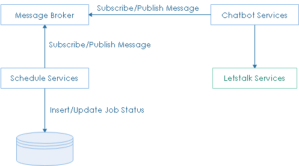
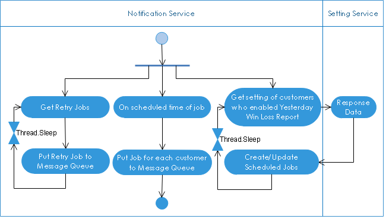
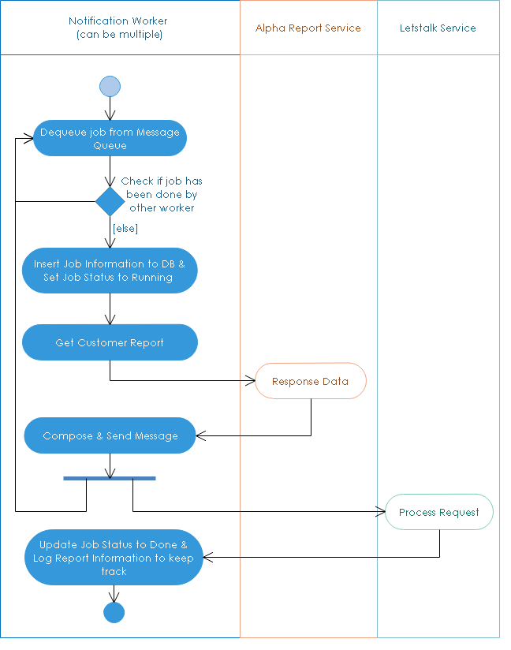

**************************
Notification Services
**************************

.. contents:: Table of Contents
   :local:
   :backlinks: top

Overview
=============================================

Notification Services are service do some scheduled job, such as sending report daily, collecting all SMA messages and push it to Letstalk service

Yesterday Win Loss
=============================================

This notification service collects SMA yesterday win loss and send in schedule, this schedule will be fixed or customized depend on SMA's chatbot setting. 

Yesterday Win Loss Notification Service includes two parts: 

- The first part, is background worker, collects all customer enabled yesterday win loss report setting, and schedule job to collect customer report data in queue. The first part also take responsibility to collect all retry jobs and put it in queue. 

- The second part includes multiple background workers, these workers enqueue job from message queue to compose report message then send to Letstalk Service.

Message & Announcement
=============================================

This notification service collects SMA message & announcement, then send it to SMA's Letstalk Account