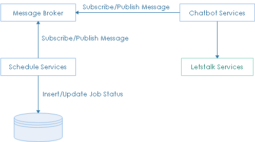
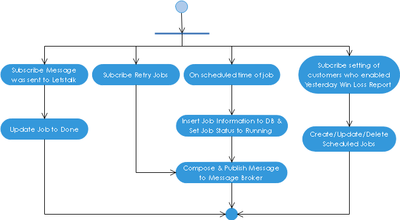

**************************
Schedule Service
**************************

Overview
=============================================

Schedule services are services do scheduled jobs, on time it will publish message for other services collect data and send to letstalk

Yesterday Win Loss
=============================================

This schedule service 
    - is background worker
    - subscribes all customer who enabled yesterday win loss, then set schedule, when schedule on time, it will create a message and publish it to message broker for other services collect data and send to letstalk
    - collects all retry jobs start it
    - update job status
    

