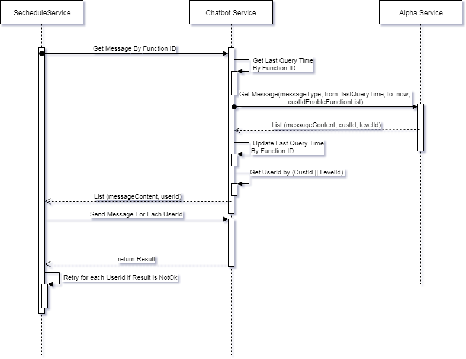
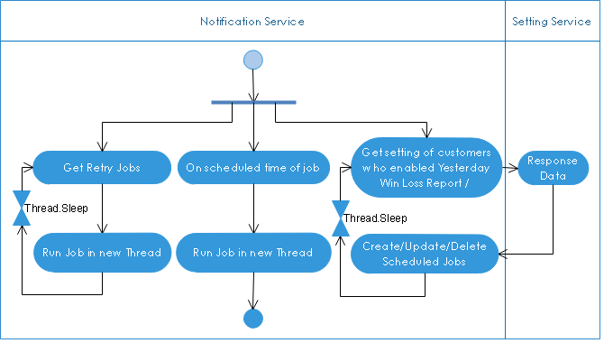
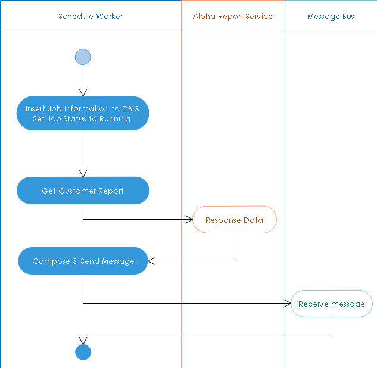

**************************
Schedule Service
**************************

.. contents:: Table of Contents
   :local:
   :backlinks: top

Overview
=============================================

Schedule services are services do scheduled jobs, such as sending report daily, collecting all SMA messages and push it to Letstalk service

Yesterday Win Loss
=============================================

This schedule service collects SMA yesterday win loss and send in schedule, this schedule will be fixed or customized depend on SMA's chatbot setting. 

Yesterday Win Loss Schedule Service includes two parts: 

- The first part:

    - is background worker
    - collects all customer enabled yesterday win loss report setting, and schedule job to collect customer report data
    - collects all retry jobs start it
    - on schedule time, it starts job worker to collect data
 

- The second part includes multiple background workers, these workers run asynchronous to collect user data.

