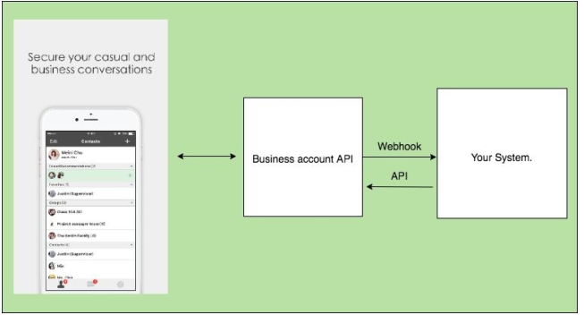

Guides
======

How it works
------------

The Business Account API allows for data to be passed between the server of your application and the Lestalk Platform.

When a user sends your business account a message, a webhook is triggered and the Letstalk Platform sends a request to your webhook URL. Your server then sends a request to the Lestalk Platform to respond to the user. Requests are sent over HTTPS in JSON format.

What you can do with Business Account API
-----------------------------------------

1. Set up a welcome message when user add account to contact.
2. Set up an auto reply message. Can be used when your service is maintained.
3. Set up an avatar image.
4. Push message to users.
5. Push various message types. (ex: text, image, imagemaps)

How to send key to contact. When webhook receive Ask Key event.
---------------------------------------------------------------

1. Receive Ask Key event, you can get ``user_id`` from source object.::

	{
		"type": "ask_key",
		"timestamp": 1527151205790,
		"source": {
			"type": "user",
			"user_id": "jimmy.chen"
		}
	}

2. Use :ref:`get-user-public-key<get-user-public-key>` API, Get user RSA public key.
3. Use user's RSA public key to encrypt business account ``hash_key`` with RSA 2048-bit encryption.
4. Use :ref:`set_key_to_user<set-key-to-user>` ​API, Set ​encryption_key to user.

How to decrypt ``hash_content``. From payload JSON String.
----------------------------------------------------------

1. Check ``hash_type`` is equal **​4**.
2. Check ``hash_id`` is the same as your own.
3. Use your own ``hash_key`` to decrypt ``hash_content`` with AES 256-bit encryption.

How to encrypt ``hash_content`` **(Plain Text)**
------------------------------------------------

1. Use your own ``hash_key`` to encrypt ``hash_content`` **(Plain Text)** with AES 256-bit encryption.