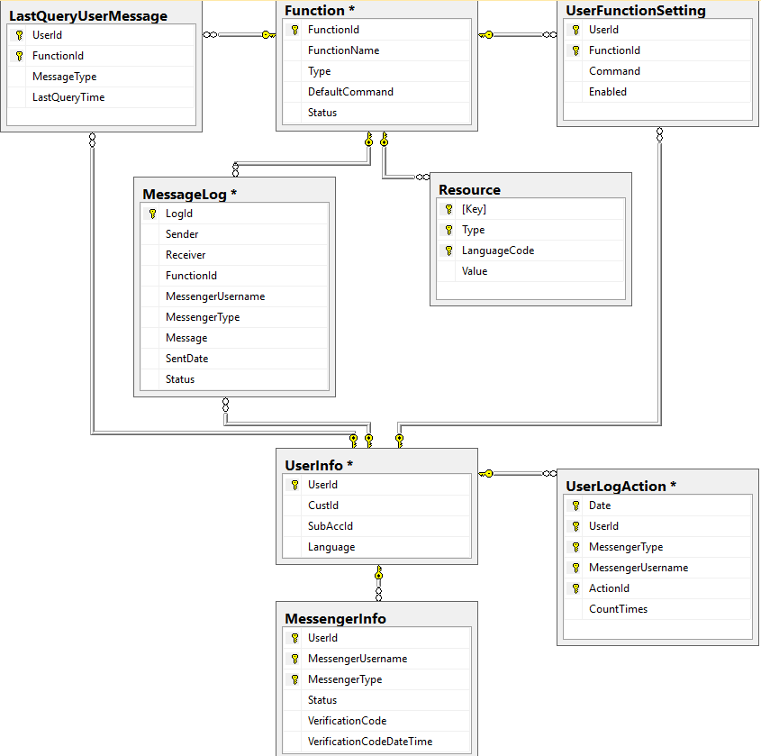

***************************
Database Design
***************************

A. Structure

1.UserInfo

.. csv-table::
   :file: Table_UserInfo.csv
   :header-rows: 1
   :widths: 50, 50, 50, 50, 50, 200

2.MessengerInfo

.. csv-table::
   :file: Table_MessengerInfo.csv
   :header-rows: 1
   :widths: 50, 50, 50, 50, 50, 200

3.Function

.. csv-table::
   :file: Table_Function.csv
   :header-rows: 1
   :widths: 50, 50, 50, 50, 50, 200

4.Resource

.. csv-table::
   :file: Table_Resource.csv
   :header-rows: 1
   :widths: 50, 50, 50, 50, 50, 200

5.MessageLog

.. csv-table::
   :file: Table_MessageLog.csv
   :header-rows: 1
   :widths: 50, 50, 50, 50, 50, 200

6.LastQueryUserMessage

.. csv-table::
   :file: Table_LastQueryUserMessage.csv
   :header-rows: 1
   :widths: 50, 50, 50, 50, 50, 200

7.UserFunctionSetting

.. csv-table::
   :file: Table_UserFunctionSetting.csv
   :header-rows: 1
   :widths: 50, 50, 50, 50, 50, 200

8.UserLogAction

.. csv-table::
   :file: Table_UserLogAction.csv
   :header-rows: 1
   :widths: 50, 50, 50, 50, 50, 200

B. ERD

