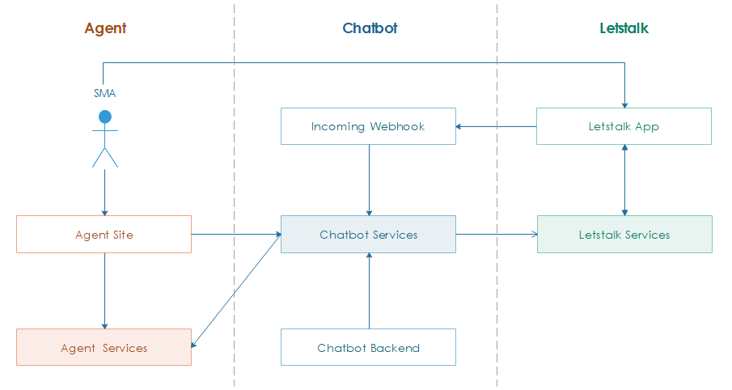

*********************
Introduction
*********************

From the traditional **n-tier architecture** point of view, system can be devided into three tiers as follows:

    1. **Presentation tier:** Letstalk app, Alpha setup page, and Chatbot backend site.
    2. **Business tier:** A collection of scalable **micro-services** which perform operations read data (queries) and update data (commands).
    3. **Data tier:** Alpha service provides SMA's data such as *customer info*, `report`, `balance`, etc.

.. note:: To outline an overview of the system architecture, placing the **Alpha site** and **Chatbot backend** at incorrect tiers is temporarily acceptable. They truly belong to the **Presentation tier**.

