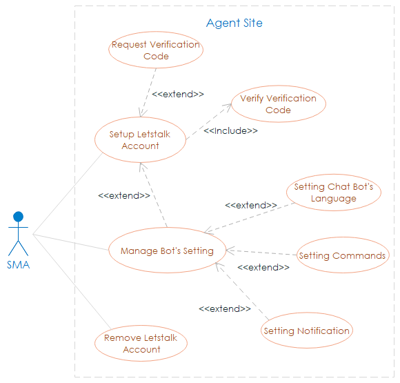
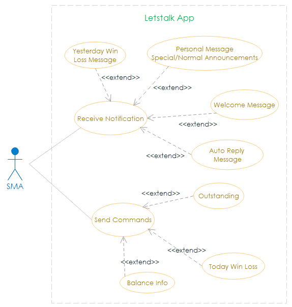

System Overview
===============

System use case diagrams below describe functions that system should peform in colloboration with SMA. 

.. note:: - To get more details about functional specification, please refer to document `Alpha chat bot via Letstalk <ttps://bit.ly/2NtRuHl>`_.
          - The use case diagrams are prerequistie knowledge before reading the system technical design.

1. Business Cases of Alpha
--------------------------

2. Business Cases of Letstalk
---------------------------------

3. Chatbot Backend Business Cases
---------------------------------

(Business cases that describe how CSD or Chatbot Admin guys manage and  run the business)

Detail will be updated ...

