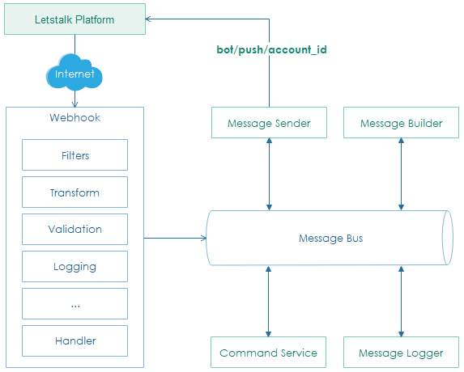
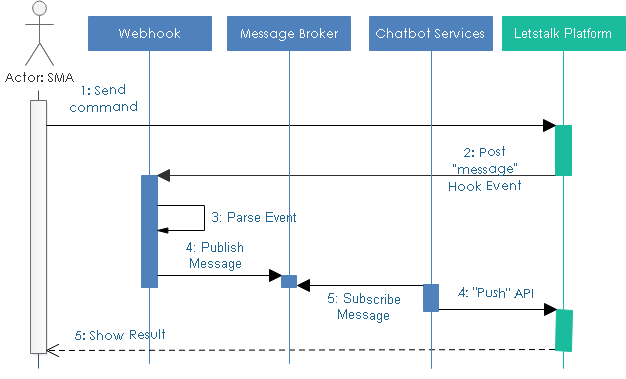

**************************
Introduction
**************************
Every time SMA chat with Letstalk App, Letstalk Platform posts an event to incoming webhook. 

Webhook receives and transform it, then send that event to right replying service endpoint for further processing.

**************************
Command
**************************

Command is text that SMA chat with bot, command can be ``outstanding``, ``win loss`` or ``balance``. 
This sequence diagram below describes how message pass to webhook and return result message to user.
In webhook, we apply memory queue to handle event one by one.

 
