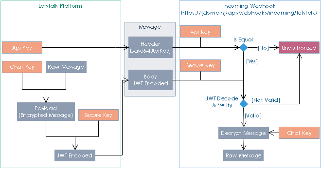

**************************
Security
**************************

In order to protect and ensure message consistency, we use JSON Web Token (jwt) in transmit data between webhook and letstalk platform.
In this implementation, we use server to server JWT. This diagram below describes how to encode & decode message.

