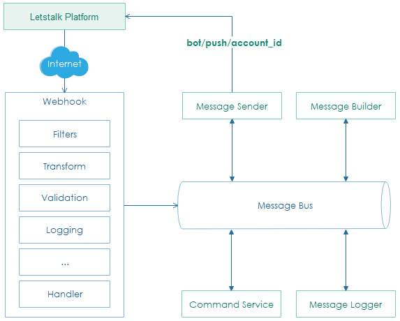

.. webhook:

Introduction
**************************

Every message sent to Chatbot will trigger **Letstalk platform (sender)** to post a request to **Chatbot webhook (receiver)**. Conversely, **Message Sender** is responsible for working with **Letstalk client** to send messages to Letstalk accounts. Additionally, **Message Logger** logs all incoming and outgoing messages passed across the border of Chatbot *bounded context* [#bc]_.

**Message Bus Pattern** [#esb]_ is applied to enable non-blocking and asynchronous architecture. It transmit authenticated requests sent from webhook to corresponding subscribers for further business processing.

.. note:: **Letstalk client** is developed by Alpha team and required to support `.NET Standard 2.x <https://docs.microsoft.com/en-us/dotnet/standard/net-standard>`_.

--------------

.. [#bc] Bounded Context https://martinfowler.com/bliki/BoundedContext.html
.. [#esb] Message Bus http://bit.ly/2NrGKZf

 
